# 构图逻辑 · 86 种

从经典比例、几何形态、空间层次到视点组织，建立画面的基础骨架。

[← 返回 350 种排版总目录](README.md)

**本类主题：** [经典法则与空间留白](#classic-rules) · [重心、线条与轴线](#balance-lines-axes) · [字母形与曲线](#letter-curves) · [几何形与放射结构](#geometry-radial) · [阵列、层叠与组群](#pattern-grouping) · [空间层次与投影](#depth-projection) · [视点、景深与空间感](#viewpoint-focus)

## 经典法则与空间留白 · 15 种

比例、视线、运动空间、负空间与框景。 `001–015`

|  |  |  |  |
| :---: | :---: | :---: | :---: |
| **001** 三分法构图 | **002** 黄金比例构图 | **003** 黄金螺旋构图 | **004** 黄金三角构图 |

|  |  |  |  |
| :---: | :---: | :---: | :---: |
| **005** 对角线法构图 | **006** 矩形折入法构图 | **007** 奇数法则构图 | **008** 空间法则构图 |

|  |  |  |  |
| :---: | :---: | :---: | :---: |
| **009** 视线空间构图 | **010** 运动空间构图 | **011** 头部空间构图 | **012** 填满画面构图 |

|  |  |  |  |
| :---: | :---: | :---: | :---: |
| **013** 负空间构图 | **014** 框中框构图 | **015** 引导线构图 | &nbsp; |

## 重心、线条与轴线 · 15 种

居中、对称、方向线、交叉线与轴线组织。 `016–030`

|  |  |  |  |
| :---: | :---: | :---: | :---: |
| **016** 居中构图 | **017** 偏心构图 | **018** 对称构图 | **019** 非对称构图 |

|  | <a href="../../v2/images/01-composition-logic/021-水平构图.png">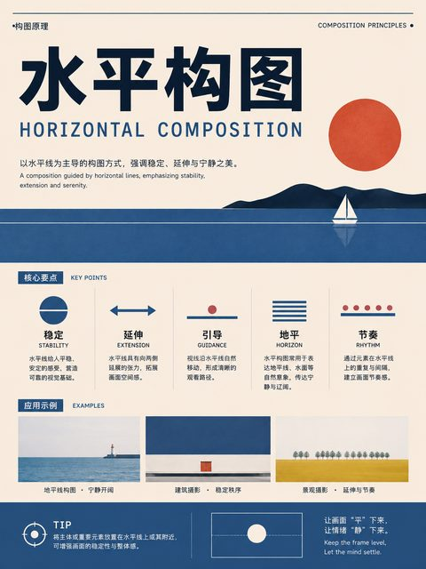</a> | <a href="../../v2/images/01-composition-logic/022-垂直构图.png">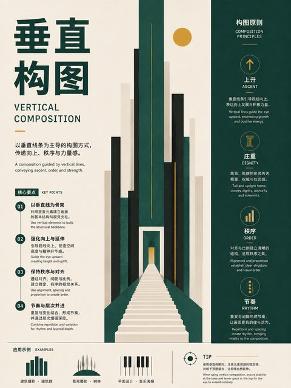</a> | <a href="../../v2/images/01-composition-logic/023-对角线构图.png">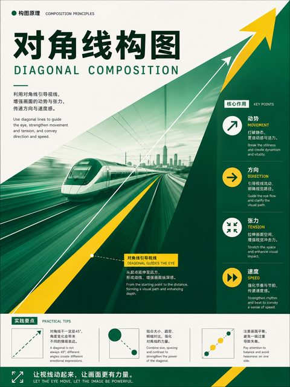</a> |
| :---: | :---: | :---: | :---: |
| **020** 镜像构图 | **021** 水平构图 | **022** 垂直构图 | **023** 对角线构图 |

| <a href="../../v2/images/01-composition-logic/024-平行线构图.png">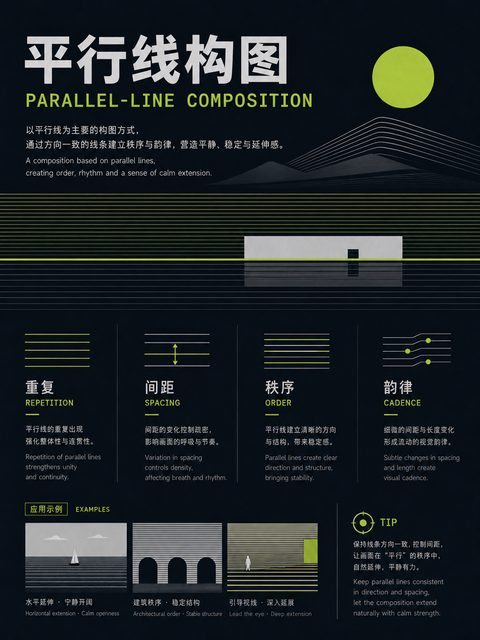</a> | <a href="../../v2/images/01-composition-logic/025-汇聚线构图.png">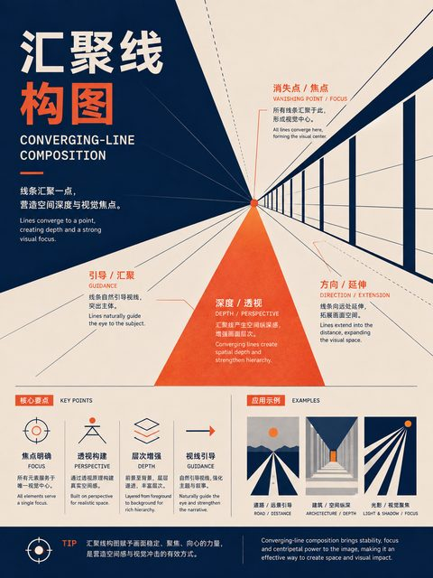</a> | <a href="../../v2/images/01-composition-logic/026-交叉线构图.png">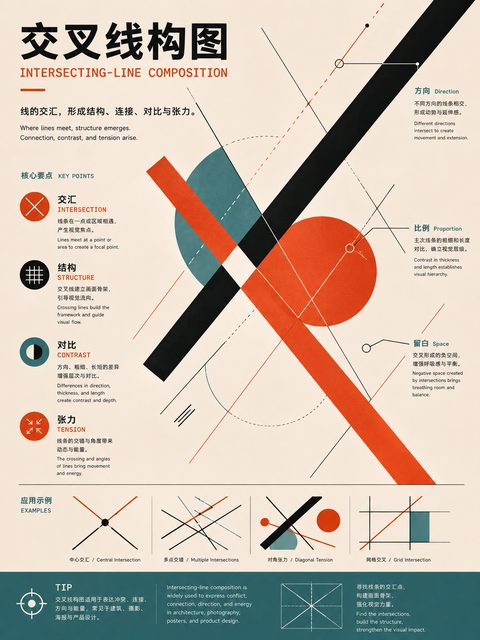</a> | <a href="../../v2/images/01-composition-logic/027-中轴构图.png">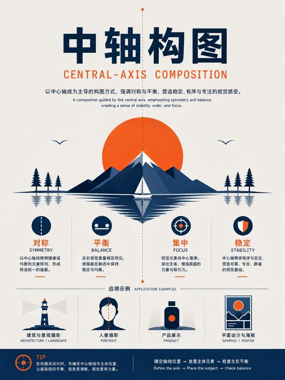</a> |
| :---: | :---: | :---: | :---: |
| **024** 平行线构图 | **025** 汇聚线构图 | **026** 交叉线构图 | **027** 中轴构图 |

| <a href="../../v2/images/01-composition-logic/028-偏轴构图.png">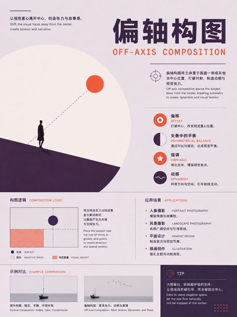</a> | <a href="../../v2/images/01-composition-logic/029-双轴构图.png">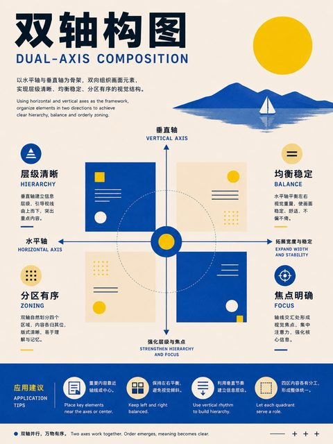</a> | <a href="../../v2/images/01-composition-logic/030-十字构图.png">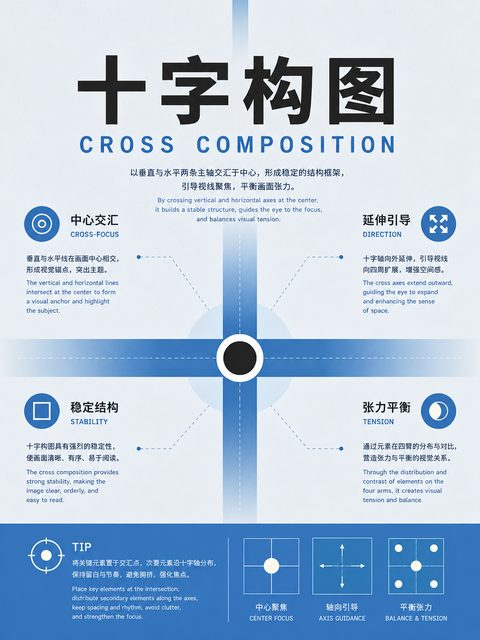</a> |  |
| :---: | :---: | :---: | :---: |
| **028** 偏轴构图 | **029** 双轴构图 | **030** 十字构图 | &nbsp; |

## 字母形与曲线 · 10 种

X、T、L、V、Z、C、S 形及曲线节奏。 `031–040`

|  |  |  |  |
| :---: | :---: | :---: | :---: |
| **031** X 形构图 | **032** T 形构图 | **033** L 形构图 | **034** V 形构图 |

|  |  |  |  |
| :---: | :---: | :---: | :---: |
| **035** Z 形构图 | **036** C 形构图 | **037** S 形构图 | **038** 曲线构图 |

|  | <a href="../../v2/images/01-composition-logic/040-锯齿形构图.png">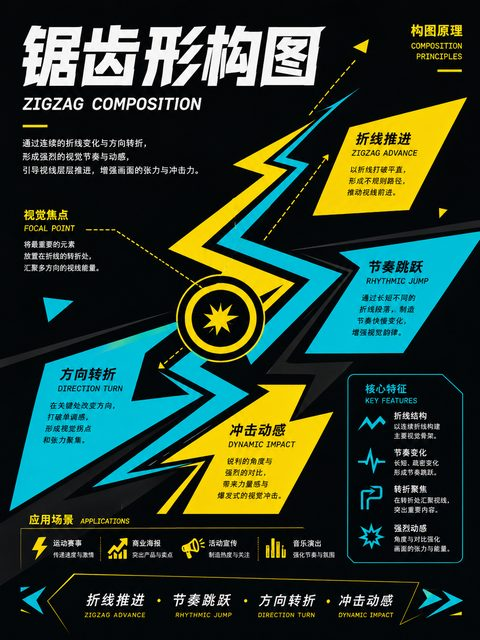</a> |  |  |
| :---: | :---: | :---: | :---: |
| **039** 波浪形构图 | **040** 锯齿形构图 | &nbsp; | &nbsp; |

## 几何形与放射结构 · 16 种

三角、矩形、圆形、螺旋、向心与离心结构。 `041–056`

| <a href="../../v2/images/01-composition-logic/041-三角构图.png">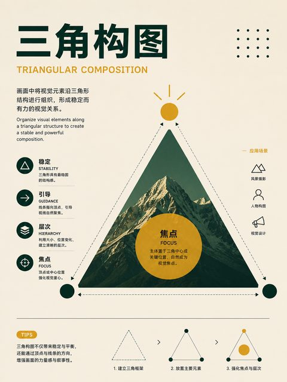</a> | <a href="../../v2/images/01-composition-logic/042-金字塔构图.png">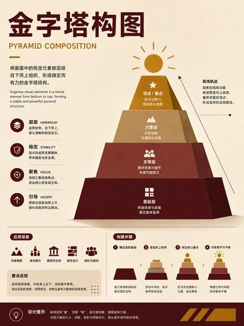</a> | <a href="../../v2/images/01-composition-logic/043-倒三角构图.png">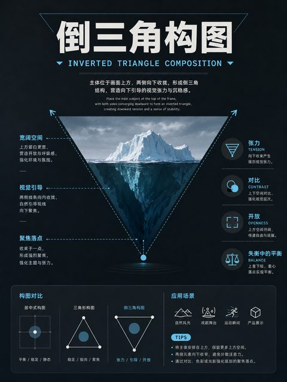</a> | <a href="../../v2/images/01-composition-logic/044-菱形构图.png">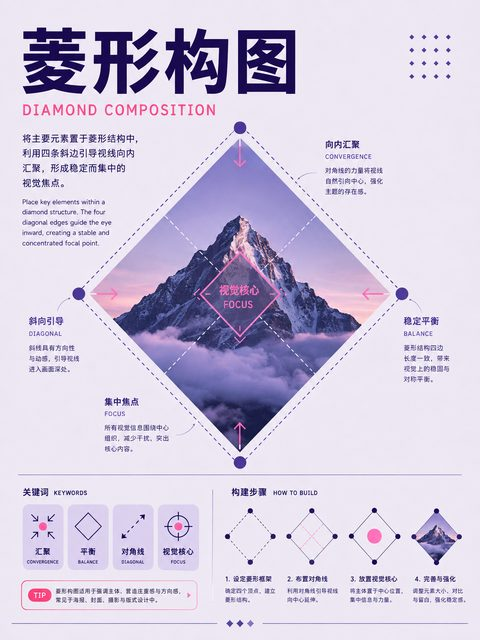</a> |
| :---: | :---: | :---: | :---: |
| **041** 三角构图 | **042** 金字塔构图 | **043** 倒三角构图 | **044** 菱形构图 |

| <a href="../../v2/images/01-composition-logic/045-方形构图.png">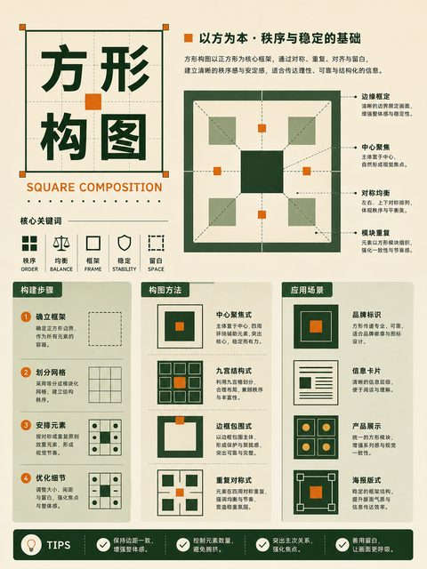</a> | <a href="../../v2/images/01-composition-logic/046-矩形构图.png">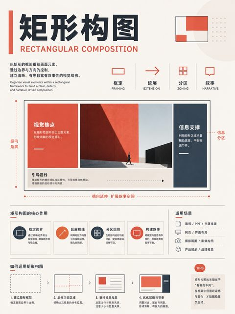</a> | <a href="../../v2/images/01-composition-logic/047-圆形构图.png">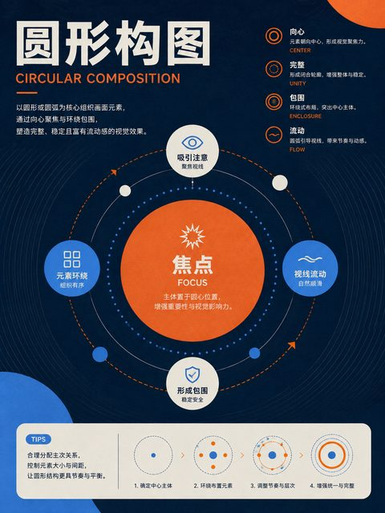</a> |  |
| :---: | :---: | :---: | :---: |
| **045** 方形构图 | **046** 矩形构图 | **047** 圆形构图 | **048** 椭圆构图 |

| <a href="../../v2/images/01-composition-logic/049-弧形构图.png">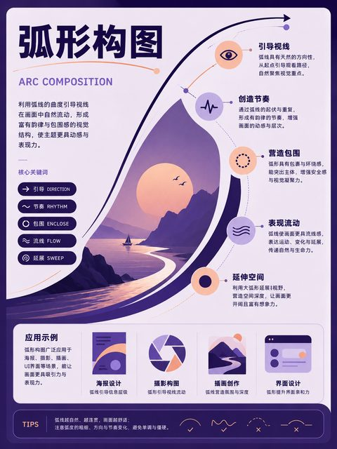</a> | <a href="../../v2/images/01-composition-logic/050-环形构图.png">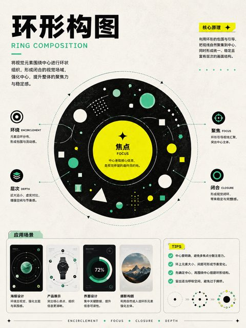</a> | <a href="../../v2/images/01-composition-logic/051-螺旋构图.png">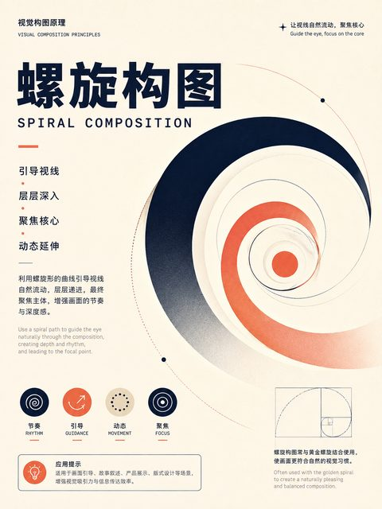</a> | <a href="../../v2/images/01-composition-logic/052-放射式构图.png">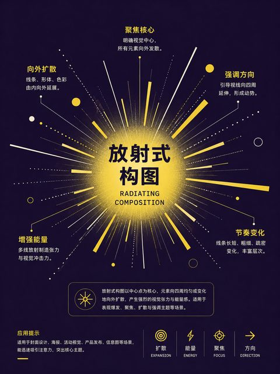</a> |
| :---: | :---: | :---: | :---: |
| **049** 弧形构图 | **050** 环形构图 | **051** 螺旋构图 | **052** 放射式构图 |

| <a href="../../v2/images/01-composition-logic/053-向心式构图.png">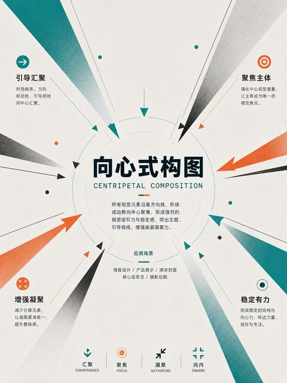</a> | <a href="../../v2/images/01-composition-logic/054-离心式构图.png">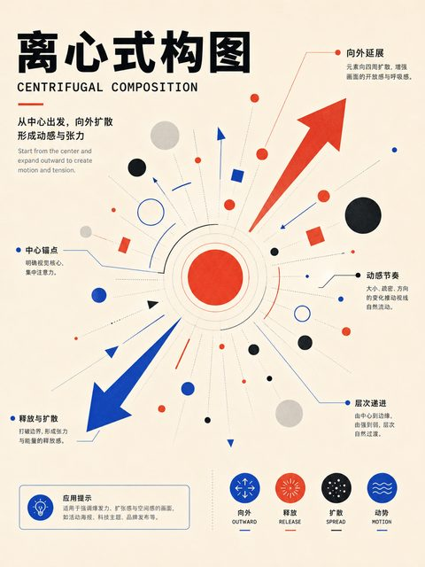</a> | <a href="../../v2/images/01-composition-logic/055-同心式构图.png">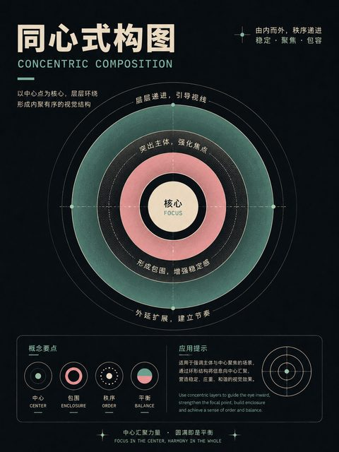</a> | <a href="../../v2/images/01-composition-logic/056-四象限构图.png">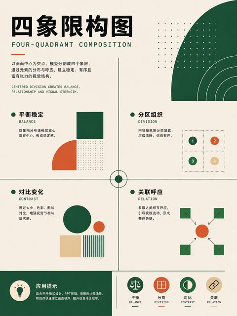</a> |
| :---: | :---: | :---: | :---: |
| **053** 向心式构图 | **054** 离心式构图 | **055** 同心式构图 | **056** 四象限构图 |

## 阵列、层叠与组群 · 8 种

棋盘、阶梯、级联、聚类、分支和网络。 `057–064`

| <a href="../../v2/images/01-composition-logic/057-棋盘构图.png">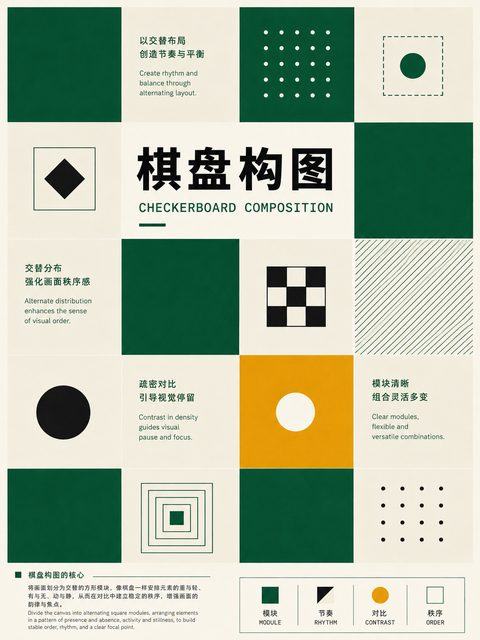</a> | <a href="../../v2/images/01-composition-logic/058-阶梯构图.png">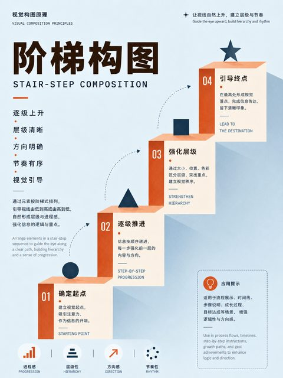</a> |  |  |
| :---: | :---: | :---: | :---: |
| **057** 棋盘构图 | **058** 阶梯构图 | **059** 层叠构图 | **060** 级联构图 |

| <a href="../../v2/images/01-composition-logic/061-聚类构图.png">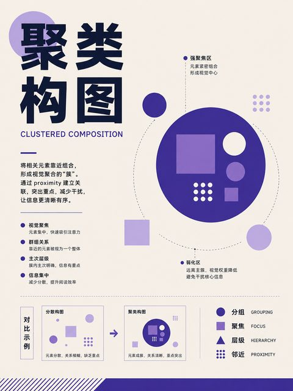</a> | <a href="../../v2/images/01-composition-logic/062-分散构图.png">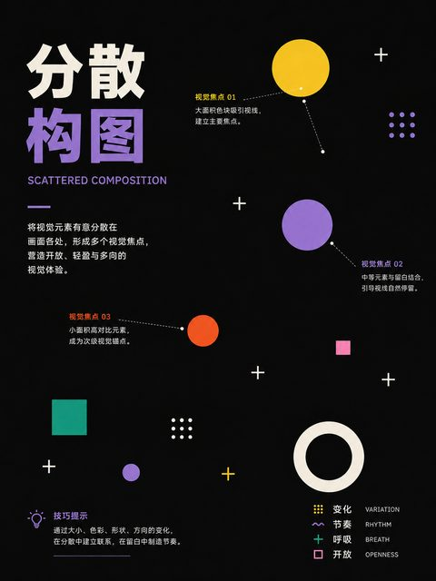</a> | <a href="../../v2/images/01-composition-logic/063-分支构图.png">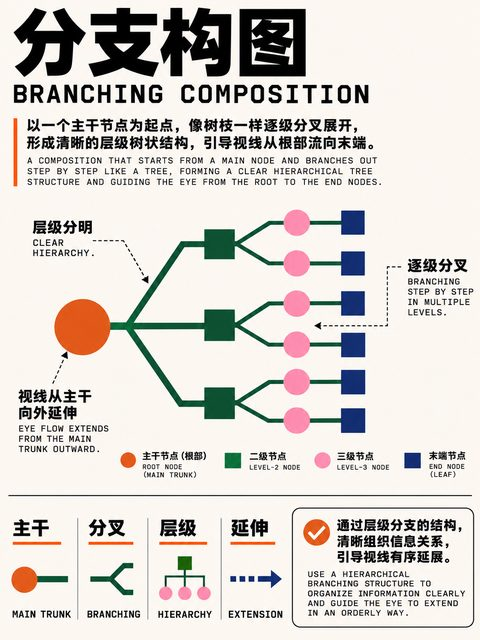</a> | <a href="../../v2/images/01-composition-logic/064-网络构图.png">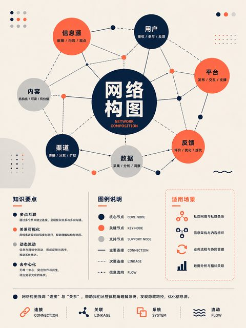</a> |
| :---: | :---: | :---: | :---: |
| **061** 聚类构图 | **062** 分散构图 | **063** 分支构图 | **064** 网络构图 |

## 空间层次与投影 · 12 种

前中后景、尺度递减、线性透视和轴测投影。 `065–076`

|  | <a href="../../v2/images/01-composition-logic/066-前景框架构图.png">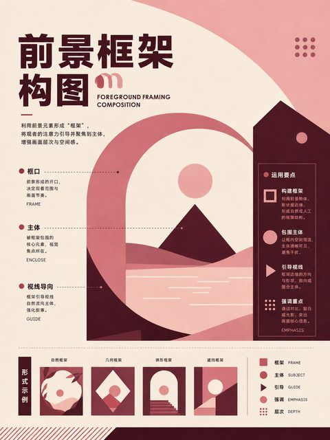</a> |  | <a href="../../v2/images/01-composition-logic/067-重叠空间构图.png">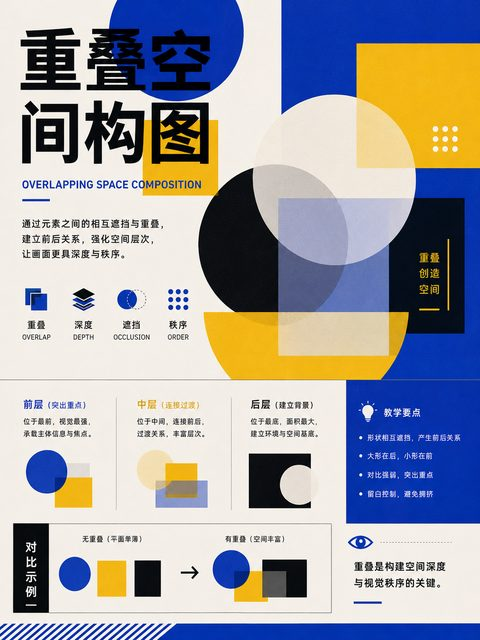</a> |
| :---: | :---: | :---: | :---: |
| **065** 前中后景构图 | **066** 前景框架构图 | **066** 前景框架构图 · 第二版 | **067** 重叠空间构图 |

| <a href="../../v2/images/01-composition-logic/068-尺度递减构图.png">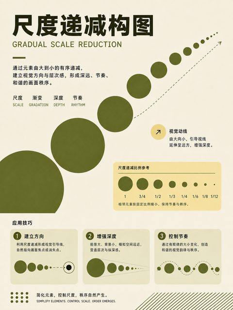</a> | <a href="../../v2/images/01-composition-logic/069-线性透视.png">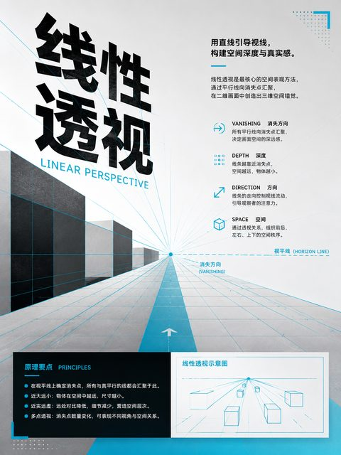</a> | <a href="../../v2/images/01-composition-logic/070-一点透视.png">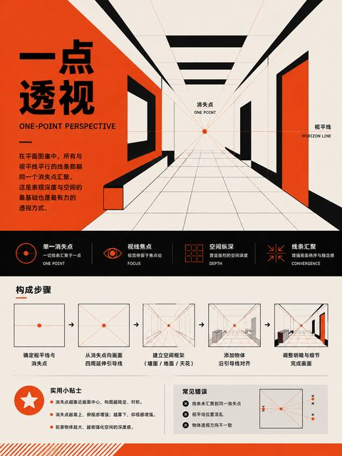</a> | <a href="../../v2/images/01-composition-logic/071-两点透视.png">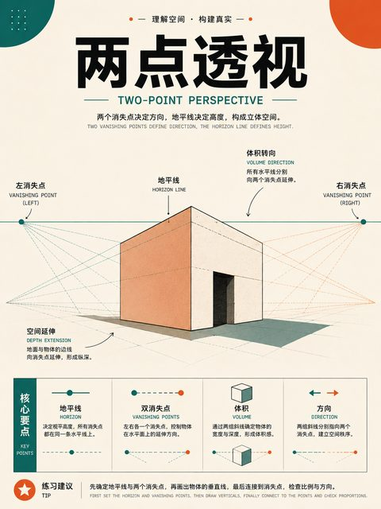</a> |
| :---: | :---: | :---: | :---: |
| **068** 尺度递减构图 | **069** 线性透视 | **070** 一点透视 | **071** 两点透视 |

| <a href="../../v2/images/01-composition-logic/072-三点透视.png">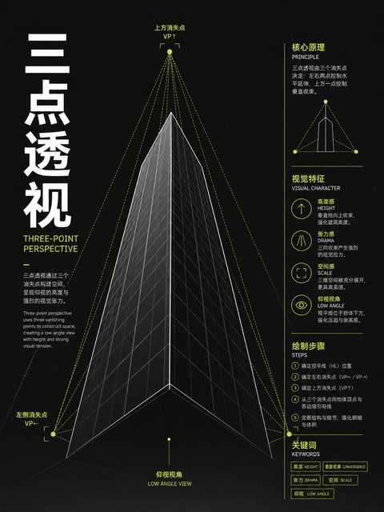</a> | <a href="../../v2/images/01-composition-logic/073-平行透视构图.png">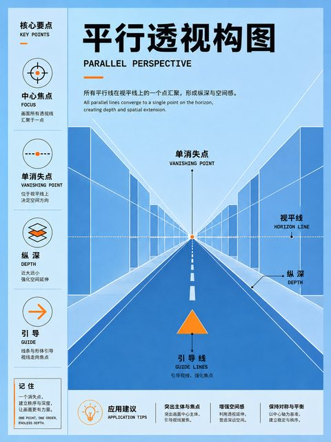</a> | <a href="../../v2/images/01-composition-logic/074-斜投影构图.png">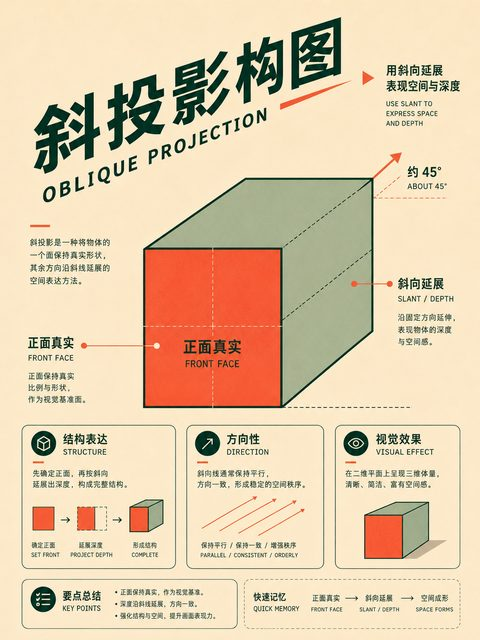</a> | <a href="../../v2/images/01-composition-logic/075-等距构图.png">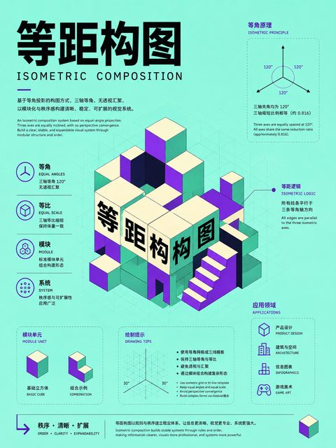</a> |
| :---: | :---: | :---: | :---: |
| **072** 三点透视 | **073** 平行透视构图 | **074** 斜投影构图 | **075** 等距构图 |

| <a href="../../v2/images/01-composition-logic/076-轴测构图.png">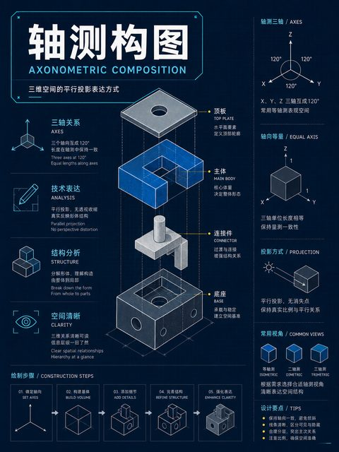</a> |  |  |  |
| :---: | :---: | :---: | :---: |
| **076** 轴测构图 | &nbsp; | &nbsp; | &nbsp; |

## 视点、景深与空间感 · 10 种

俯仰视角、强制透视、景深与平面化。 `077–086`

| <a href="../../v2/images/01-composition-logic/077-鸟瞰构图.png">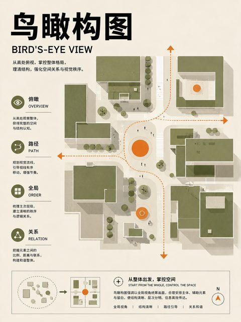</a> |  | <a href="../../v2/images/01-composition-logic/079-顶视构图.png">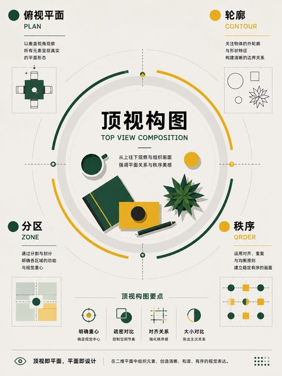</a> | <a href="../../v2/images/01-composition-logic/080-平视构图.png">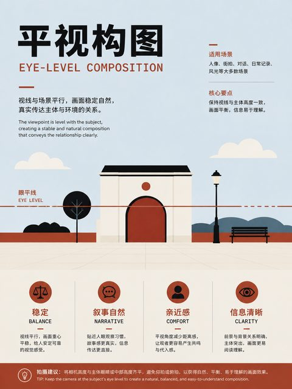</a> |
| :---: | :---: | :---: | :---: |
| **077** 鸟瞰构图 | **078** 虫视构图 | **079** 顶视构图 | **080** 平视构图 |

| <a href="../../v2/images/01-composition-logic/081-强制透视构图.png">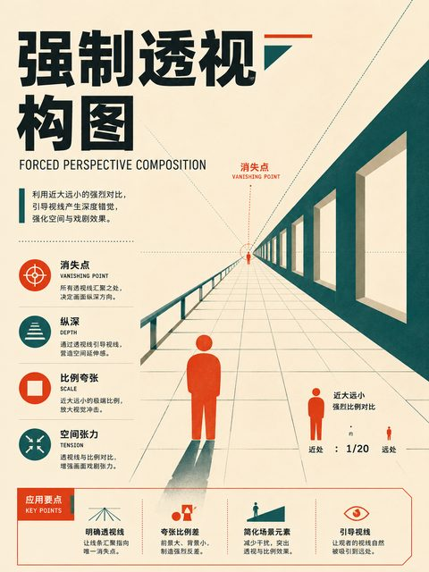</a> | <a href="../../v2/images/01-composition-logic/082-空气透视构图.png">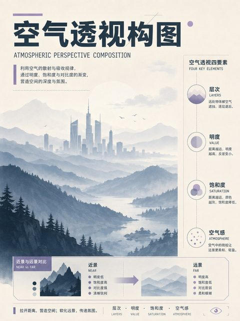</a> |  |  |
| :---: | :---: | :---: | :---: |
| **081** 强制透视构图 | **082** 空气透视构图 | **083** 浅景深构图 | **084** 深焦构图 |

|  | <a href="../../v2/images/01-composition-logic/086-深空间构图.png">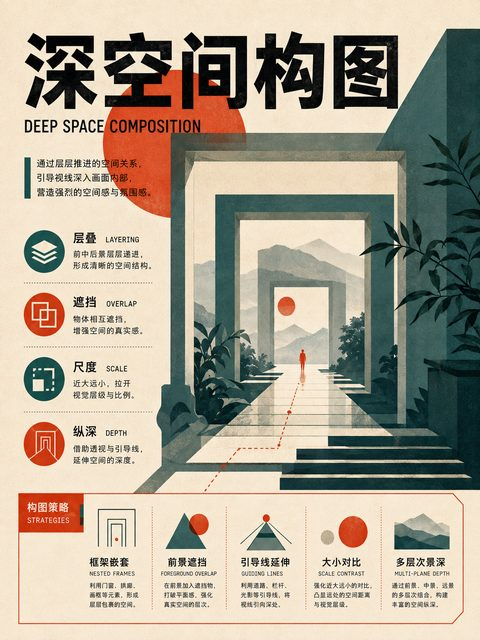</a> |  |  |
| :---: | :---: | :---: | :---: |
| **085** 平面化构图 | **086** 深空间构图 | &nbsp; | &nbsp; |
