# 网页与 UI · 79 种

[总⁠览](README.md) · [0⁠1⁠ ⁠构⁠图⁠逻⁠辑](01-composition-logic.md) 86 · [0⁠2⁠ ⁠视⁠觉⁠原⁠则](02-visual-principles.md) 45 · [0⁠3⁠ ⁠出⁠版⁠广⁠告](03-editorial-advertising.md) 36 · [0⁠4⁠ ⁠字⁠体⁠网⁠格](04-type-grid-cjk.md) 54 · 0⁠5⁠ ⁠网⁠页⁠ ⁠U⁠I 79 · [0⁠6⁠ ⁠影⁠视⁠画⁠面](06-film-frame.md) 14 · [0⁠7⁠ ⁠中⁠国⁠传⁠统](07-chinese-composition.md) 20 · [0⁠8⁠ ⁠演⁠示⁠文⁠稿](08-presentation.md) 16

收录网站和产品界面的导航、内容、表单与响应式布局模式。

**本类主题：** [CSS 流、定位与响应](#css-layout) · [布局原语](#layout-primitives) · [页面框架与导航](#page-navigation) · [内容与产品模式](#product-patterns) · [响应式重排模式](#responsive-patterns)

## CSS 流、定位与响应 · 21 种

普通流、Flex、Grid、定位、多栏和容器查询。 `222–242`

| <a href="../../v2/images/05-web-ui/222-普通流布局.png">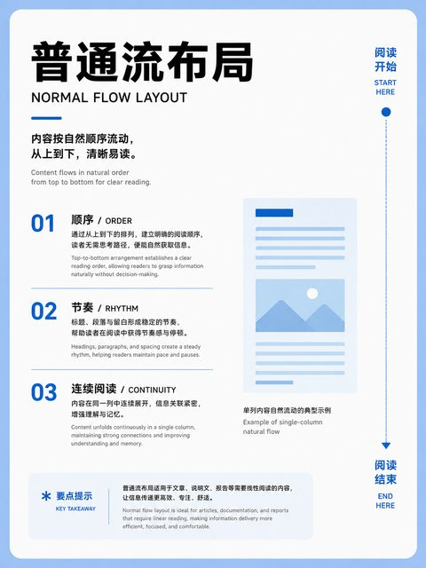</a> | <a href="../../v2/images/05-web-ui/223-块级布局.png">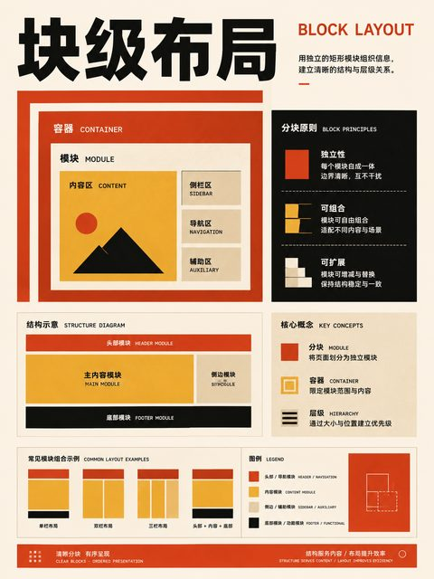</a> | <a href="../../v2/images/05-web-ui/224-行内布局.png">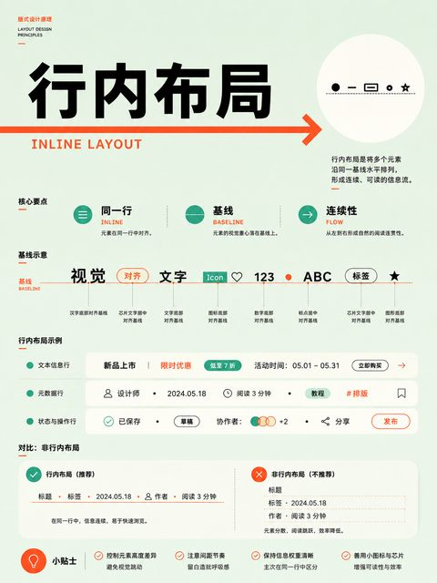</a> | <a href="../../v2/images/05-web-ui/225-流根布局.png">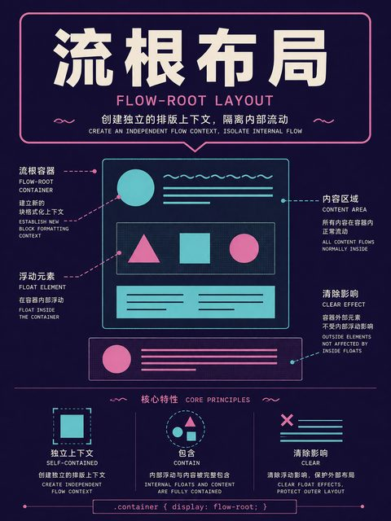</a> |
| :---: | :---: | :---: | :---: |
| **222** 普通流布局 | **223** 块级布局 | **224** 行内布局 | **225** 流根布局 |

| <a href="../../v2/images/05-web-ui/226-弹性盒布局.png">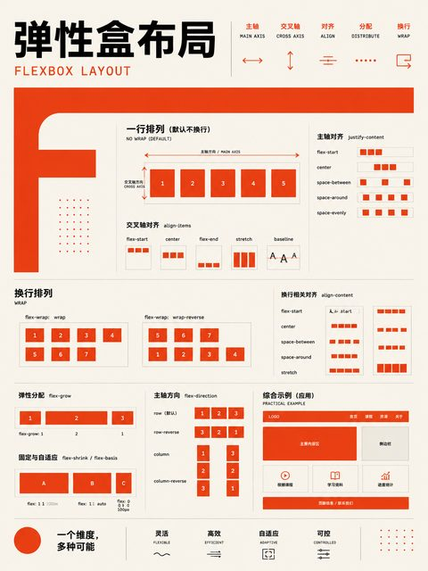</a> | <a href="../../v2/images/05-web-ui/227-网格布局.png">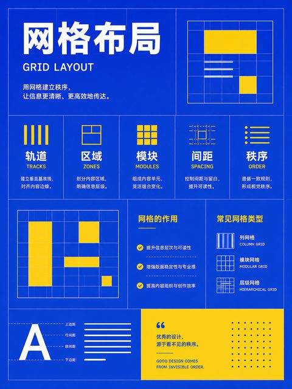</a> | <a href="../../v2/images/05-web-ui/228-子网格布局.png">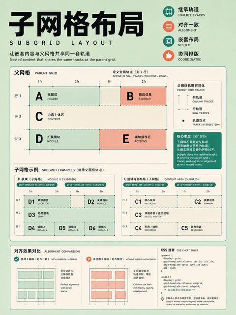</a> | <a href="../../v2/images/05-web-ui/229-多栏布局.png">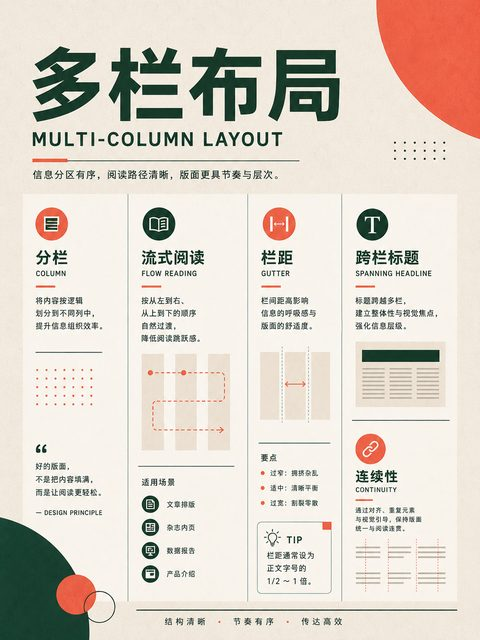</a> |
| :---: | :---: | :---: | :---: |
| **226** 弹性盒布局 | **227** 网格布局 | **228** 子网格布局 | **229** 多栏布局 |

| <a href="../../v2/images/05-web-ui/230-表格布局.png">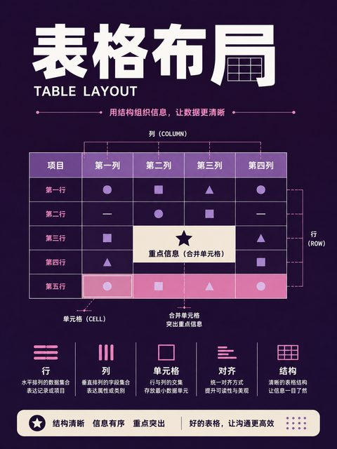</a> | <a href="../../v2/images/05-web-ui/231-浮动布局.png">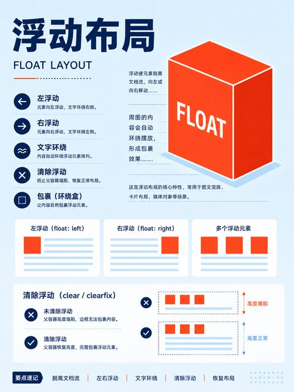</a> | <a href="../../v2/images/05-web-ui/232-相对定位布局.png">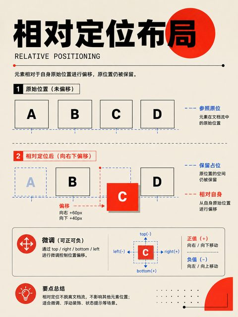</a> | <a href="../../v2/images/05-web-ui/233-绝对定位布局.png">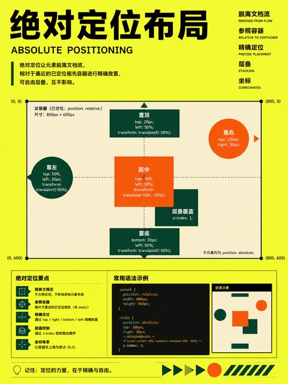</a> |
| :---: | :---: | :---: | :---: |
| **230** 表格布局 | **231** 浮动布局 | **232** 相对定位布局 | **233** 绝对定位布局 |

| <a href="../../v2/images/05-web-ui/234-固定定位布局.png">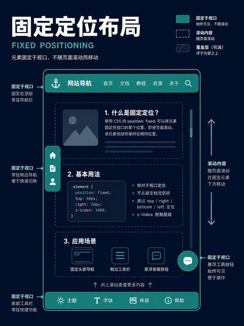</a> | <a href="../../v2/images/05-web-ui/235-粘性定位布局.png">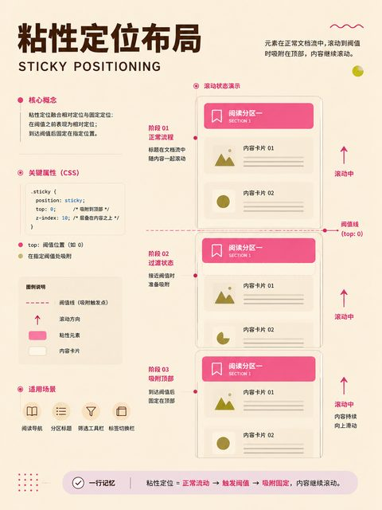</a> | <a href="../../v2/images/05-web-ui/236-瀑布流布局.png">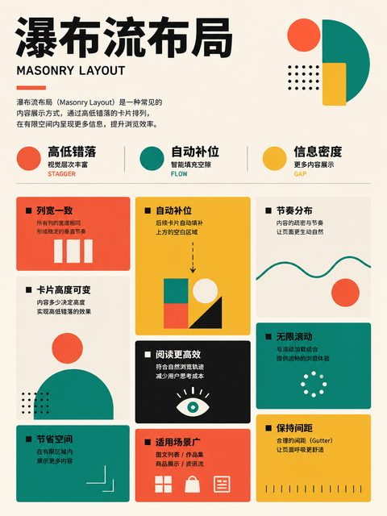</a> | <a href="../../v2/images/05-web-ui/237-覆盖布局.png">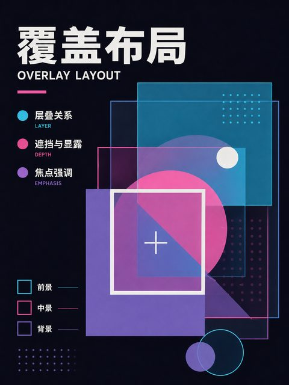</a> |
| :---: | :---: | :---: | :---: |
| **234** 固定定位布局 | **235** 粘性定位布局 | **236** 瀑布流布局 | **237** 覆盖布局 |

| <a href="../../v2/images/05-web-ui/238-固定宽度布局.png">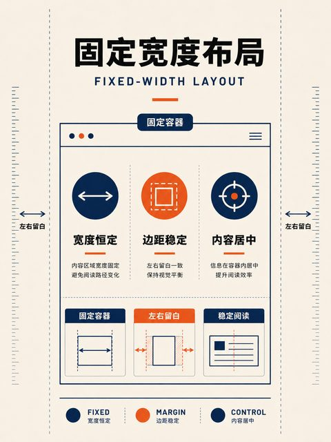</a> | <a href="../../v2/images/05-web-ui/239-流体布局.png">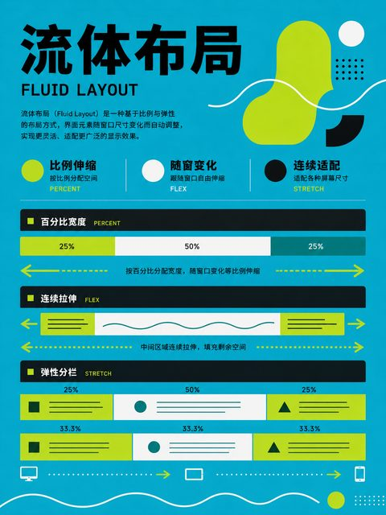</a> | <a href="../../v2/images/05-web-ui/240-响应式布局.png">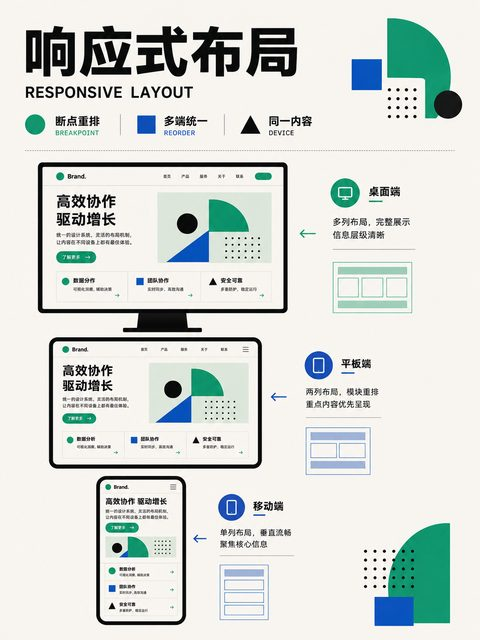</a> | <a href="../../v2/images/05-web-ui/241-自适应布局.png">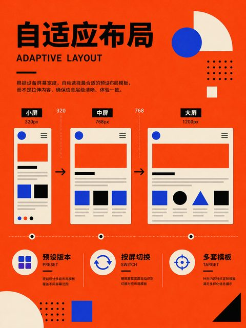</a> |
| :---: | :---: | :---: | :---: |
| **238** 固定宽度布局 | **239** 流体布局 | **240** 响应式布局 | **241** 自适应布局 |

| <a href="../../v2/images/05-web-ui/242-容器查询布局.png">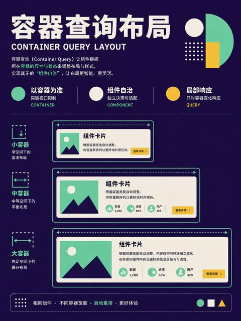</a> |  |  |  |
| :---: | :---: | :---: | :---: |
| **242** 容器查询布局 | &nbsp; | &nbsp; | &nbsp; |

## 布局原语 · 12 种

堆栈、盒子、簇群、侧栏、切换器、封面与悬浮层。 `243–254`

| <a href="../../v2/images/05-web-ui/243-堆栈.png">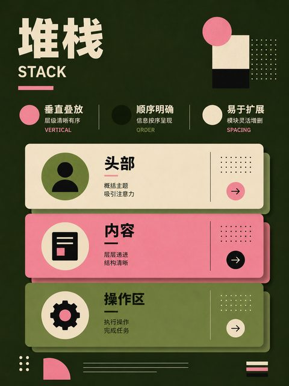</a> | <a href="../../v2/images/05-web-ui/244-盒子.png">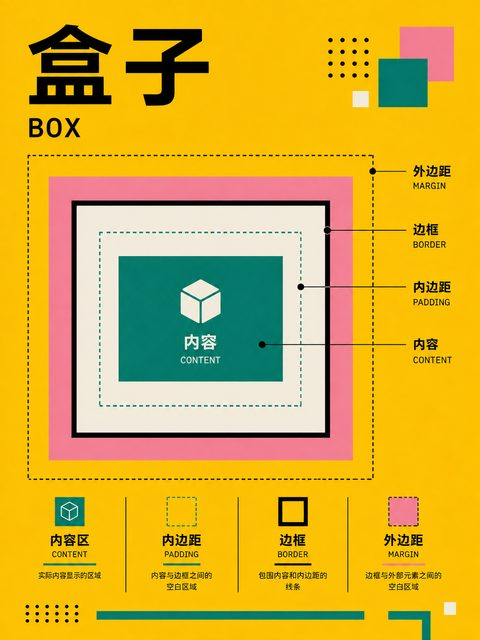</a> | <a href="../../v2/images/05-web-ui/245-居中器.png">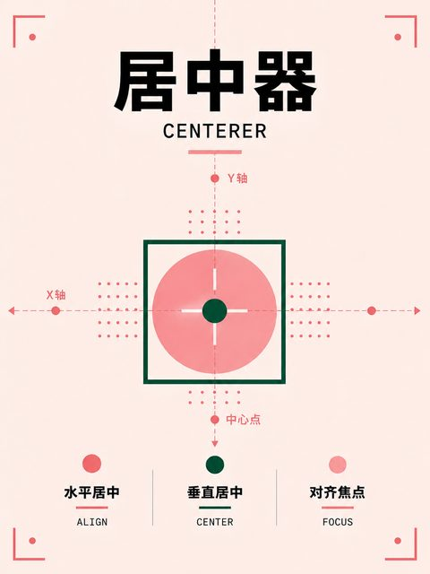</a> | <a href="../../v2/images/05-web-ui/246-簇群.png">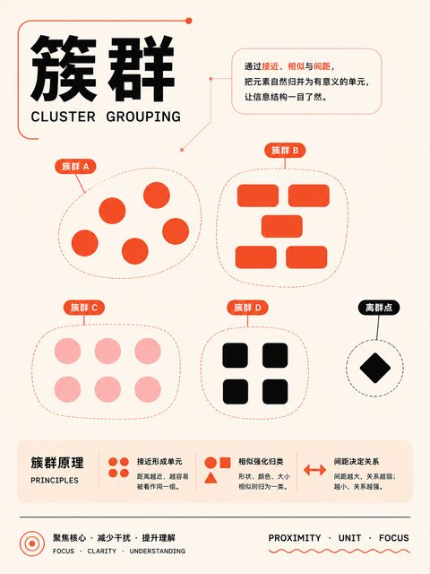</a> |
| :---: | :---: | :---: | :---: |
| **243** 堆栈 | **244** 盒子 | **245** 居中器 | **246** 簇群 |

| <a href="../../v2/images/05-web-ui/247-侧栏原语.png">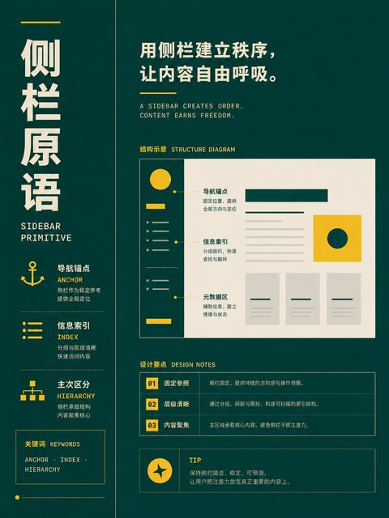</a> | <a href="../../v2/images/05-web-ui/248-切换器.png">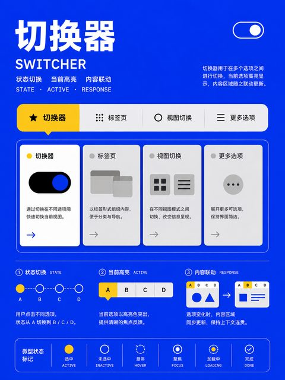</a> | <a href="../../v2/images/05-web-ui/249-封面原语.png">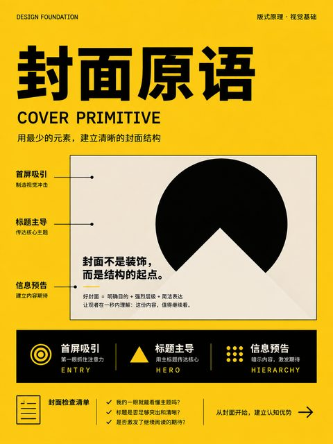</a> | <a href="../../v2/images/05-web-ui/250-自适应网格原语.png">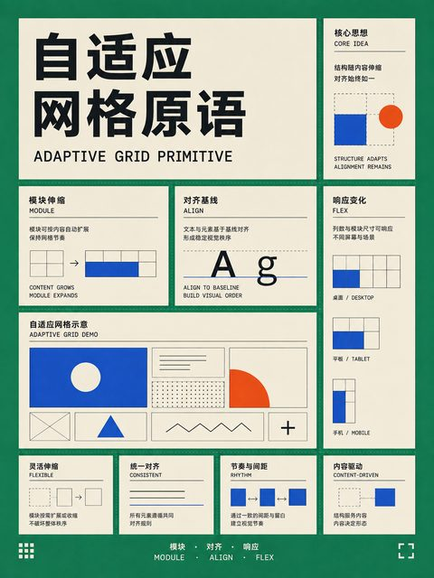</a> |
| :---: | :---: | :---: | :---: |
| **247** 侧栏原语 | **248** 切换器 | **249** 封面原语 | **250** 自适应网格原语 |

| <a href="../../v2/images/05-web-ui/251-比例框.png">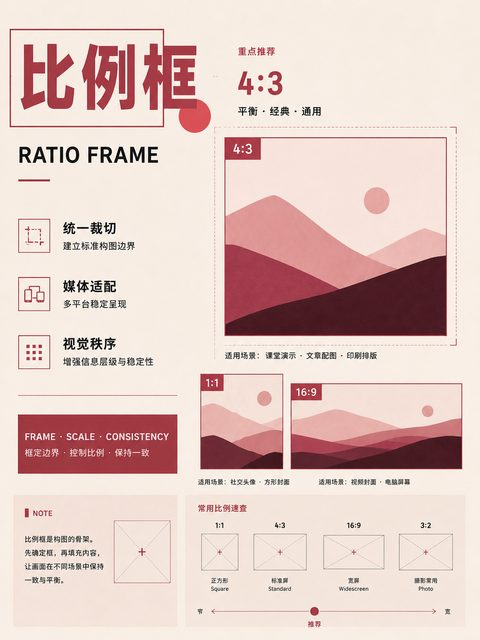</a> | <a href="../../v2/images/05-web-ui/252-横向卷轴.png">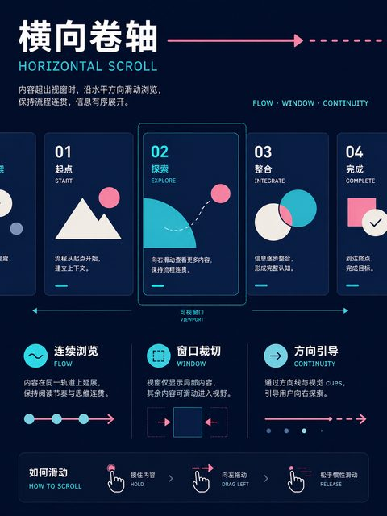</a> | <a href="../../v2/images/05-web-ui/253-悬浮层.png">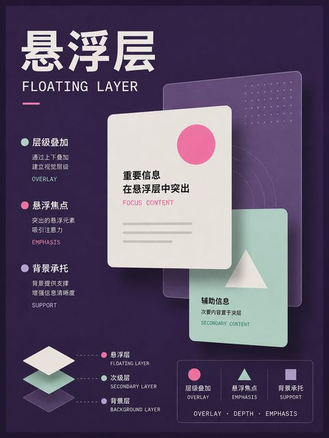</a> | <a href="../../v2/images/05-web-ui/254-图标文字组合.png">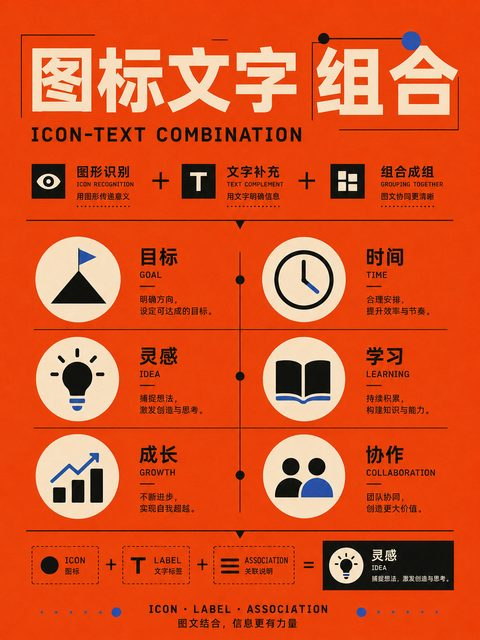</a> |
| :---: | :---: | :---: | :---: |
| **251** 比例框 | **252** 横向卷轴 | **253** 悬浮层 | **254** 图标文字组合 |

## 页面框架与导航 · 14 种

多列、分屏、页眉页脚、标签页、抽屉和列表详情。 `255–268`

| <a href="../../v2/images/05-web-ui/255-单列页面.png">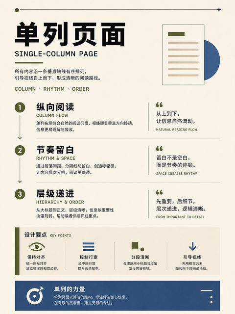</a> | <a href="../../v2/images/05-web-ui/256-双列页面.png">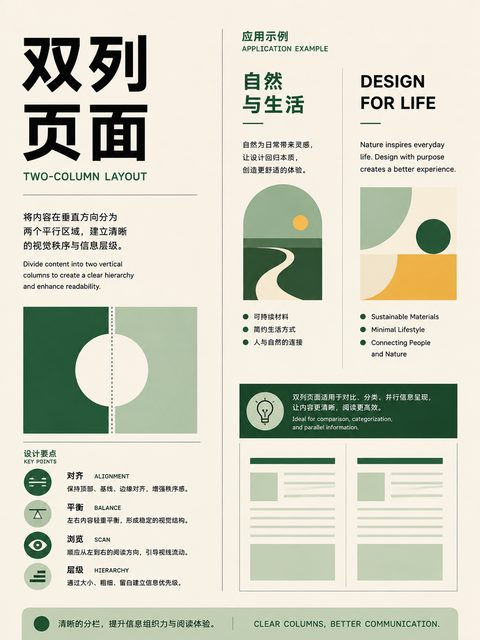</a> | <a href="../../v2/images/05-web-ui/257-三列页面.png">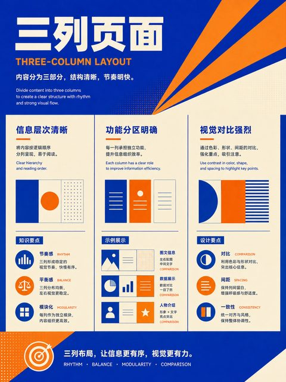</a> | <a href="../../v2/images/05-web-ui/258-侧边栏页面.png">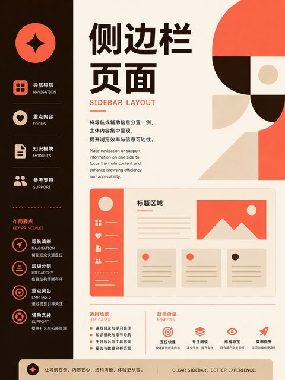</a> |
| :---: | :---: | :---: | :---: |
| **255** 单列页面 | **256** 双列页面 | **257** 三列页面 | **258** 侧边栏页面 |

| <a href="../../v2/images/05-web-ui/259-分屏布局.png">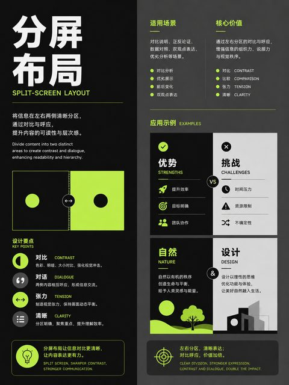</a> | <a href="../../v2/images/05-web-ui/260-圣杯布局.png">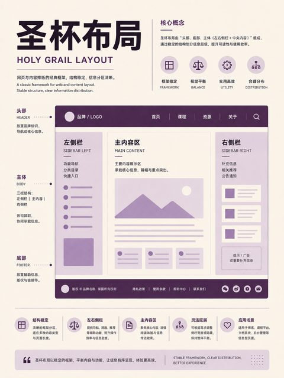</a> | <a href="../../v2/images/05-web-ui/261-页眉—主体—页脚.png">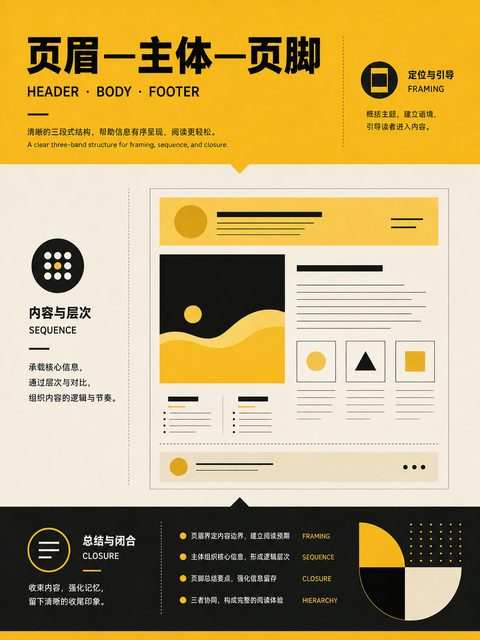</a> | <a href="../../v2/images/05-web-ui/262-顶部导航布局.png">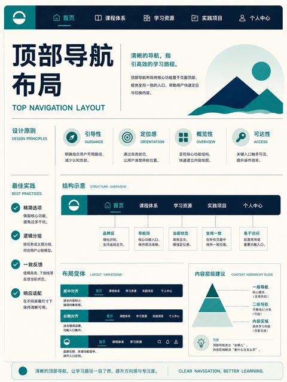</a> |
| :---: | :---: | :---: | :---: |
| **259** 分屏布局 | **260** 圣杯布局 | **261** 页眉—主体—页脚 | **262** 顶部导航布局 |

| <a href="../../v2/images/05-web-ui/263-导航抽屉布局.png">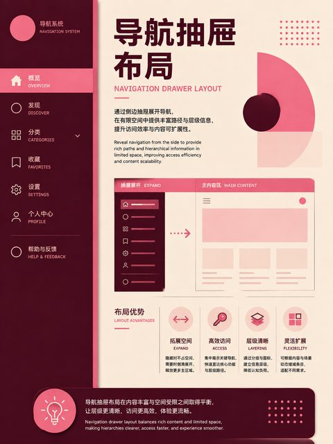</a> | <a href="../../v2/images/05-web-ui/264-底部导航布局.png">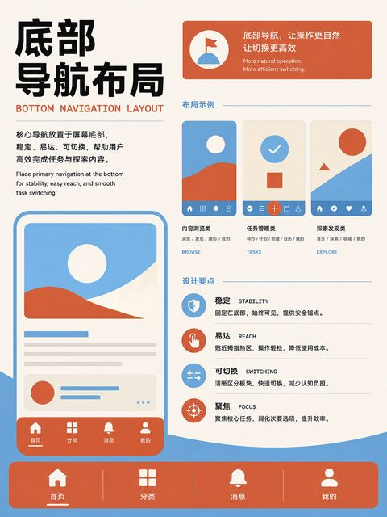</a> | <a href="../../v2/images/05-web-ui/265-标签页布局.png">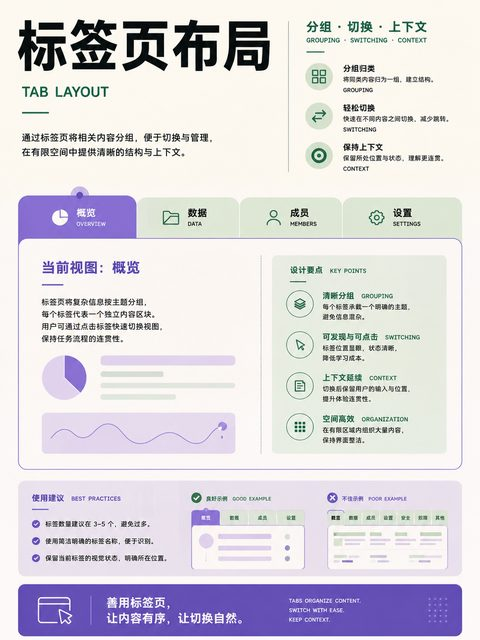</a> | <a href="../../v2/images/05-web-ui/266-手风琴布局.png">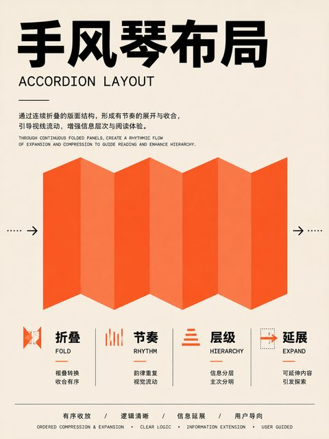</a> |
| :---: | :---: | :---: | :---: |
| **263** 导航抽屉布局 | **264** 底部导航布局 | **265** 标签页布局 | **266** 手风琴布局 |

| <a href="../../v2/images/05-web-ui/267-列表—详情布局.png">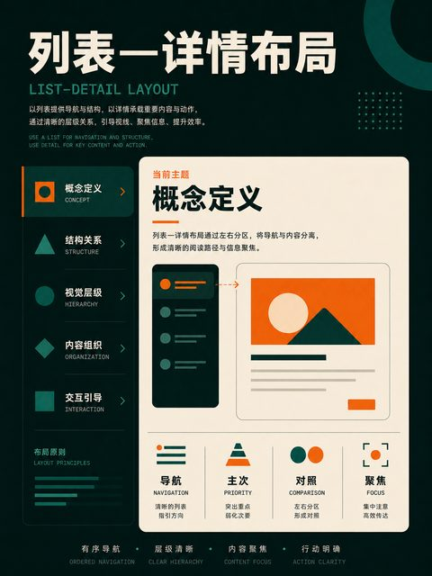</a> | <a href="../../v2/images/05-web-ui/268-辅助窗格布局.png">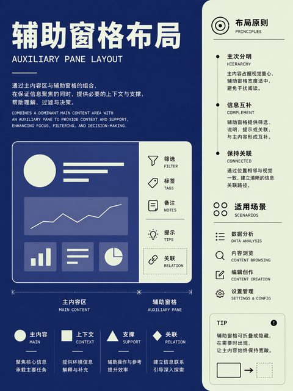</a> |  |  |
| :---: | :---: | :---: | :---: |
| **267** 列表—详情布局 | **268** 辅助窗格布局 | &nbsp; | &nbsp; |

## 内容与产品模式 · 22 种

信息流、卡片、仪表盘、表格、表单、画廊与工作区。 `269–290`

| <a href="../../v2/images/05-web-ui/269-信息流布局.png">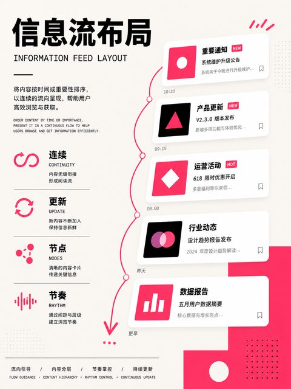</a> | <a href="../../v2/images/05-web-ui/270-卡片网格布局.png">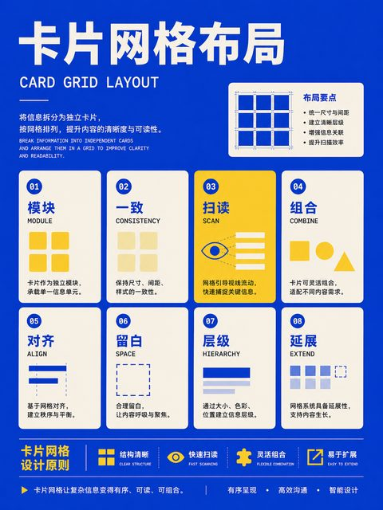</a> |  | <a href="../../v2/images/05-web-ui/272-便当盒布局.png">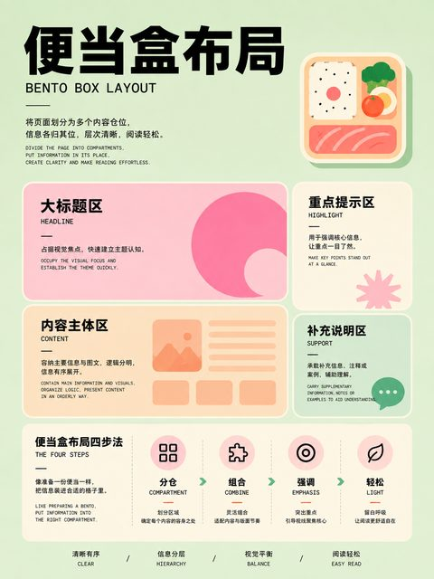</a> |
| :---: | :---: | :---: | :---: |
| **269** 信息流布局 | **270** 卡片网格布局 | **271** 瀑布流页面 | **272** 便当盒布局 |

|  |  |  |  |
| :---: | :---: | :---: | :---: |
| **273** 仪表盘布局 | **274** 数据表格布局 | **275** 画廊布局 | **276** 轮播布局 |

|  |  |  |  |
| :---: | :---: | :---: | :---: |
| **277** 时间线布局 | **278** 看板布局 | **279** 日历布局 | **280** 树形浏览布局 |

|  |  |  |  |
| :---: | :---: | :---: | :---: |
| **281** 对话布局 | **282** 地图主导布局 | **283** 画布工作区布局 | **284** 表单布局 |

|  |  |  |  |
| :---: | :---: | :---: | :---: |
| **285** 分步表单 | **286** 搜索结果布局 | **287** 设置页面布局 | **288** 媒体对象布局 |

|  |  |  |  |
| :---: | :---: | :---: | :---: |
| **289** Hero 主视觉布局 | **290** 分层导航布局 | &nbsp; | &nbsp; |

## 响应式重排模式 · 10 种

列下落、布局切换、画布外、堆叠和组件级响应。 `291–300`

|  |  |  |  |
| :---: | :---: | :---: | :---: |
| **291** 大体流动模式 | **292** 列下落模式 | **293** 布局切换模式 | **294** 微调模式 |

|  |  |  |  |
| :---: | :---: | :---: | :---: |
| **295** 画布外模式 | **296** 堆叠重排 | **297** 顺序重排 | **298** 折叠双窗格 |

|  |  |  |  |
| :---: | :---: | :---: | :---: |
| **299** 自适应网格 | **300** 组件级响应布局 | &nbsp; | &nbsp; |
