# 中国传统构图 · 20 种

[总⁠览](README.md) · [0⁠1⁠ ⁠构⁠图⁠逻⁠辑](01-composition-logic.md) 86 · [0⁠2⁠ ⁠视⁠觉⁠原⁠则](02-visual-principles.md) 45 · [0⁠3⁠ ⁠出⁠版⁠广⁠告](03-editorial-advertising.md) 36 · [0⁠4⁠ ⁠字⁠体⁠网⁠格](04-type-grid-cjk.md) 54 · [0⁠5⁠ ⁠网⁠页⁠ ⁠U⁠I](05-web-ui.md) 79 · [0⁠6⁠ ⁠影⁠视⁠画⁠面](06-film-frame.md) 14 · 0⁠7⁠ ⁠中⁠国⁠传⁠统 20 · [0⁠8⁠ ⁠演⁠示⁠文⁠稿](08-presentation.md) 16

整理中国绘画与传统视觉中的空间经营、散点透视和章法。

**本类主题：** [三远、透视与游观](#perspective-roaming) · [取景与景式](#scene-framing) · [留白、虚实与章法](#blank-rhythm)

## 三远、透视与游观 · 6 种

高远、深远、平远、散点透视与游观式构图。 `315–320`

| <a href="../../v2/images/07-chinese-composition/315-高远法.png">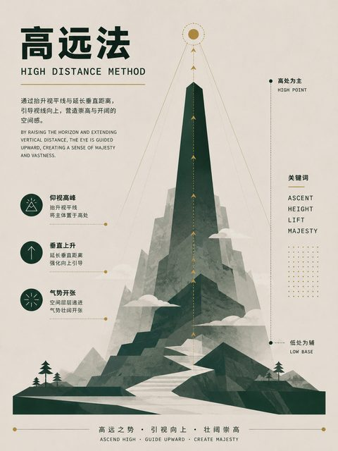</a> | <a href="../../v2/images/07-chinese-composition/316-深远法.png">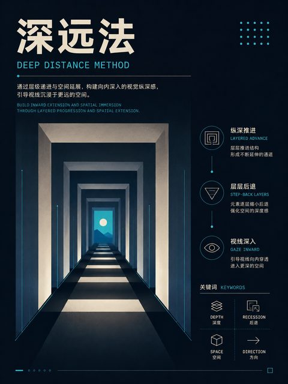</a> | <a href="../../v2/images/07-chinese-composition/317-平远法.png">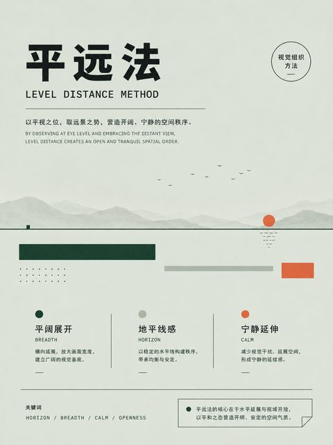</a> | <a href="../../v2/images/07-chinese-composition/318-三远综合构图.png">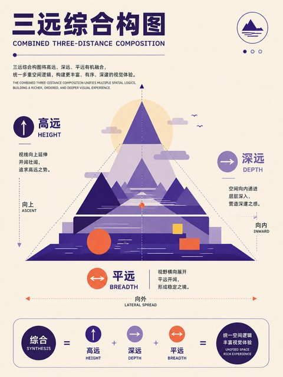</a> |
| :---: | :---: | :---: | :---: |
| **315** 高远法 | **316** 深远法 | **317** 平远法 | **318** 三远综合构图 |

|  |  |  |  |
| :---: | :---: | :---: | :---: |
| **319** 散点透视 | **320** 游观式构图 | &nbsp; | &nbsp; |

## 取景与景式 · 5 种

全景、一河两岸、边角、截景和折枝。 `321–325`

| <a href="../../v2/images/07-chinese-composition/321-全景式构图.png">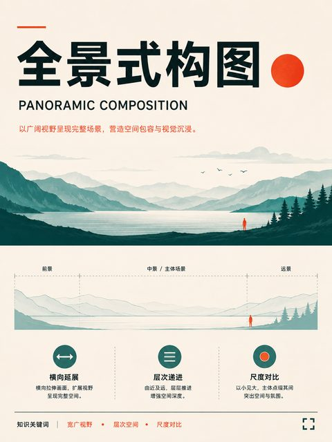</a> | <a href="../../v2/images/07-chinese-composition/322-一河两岸式.png">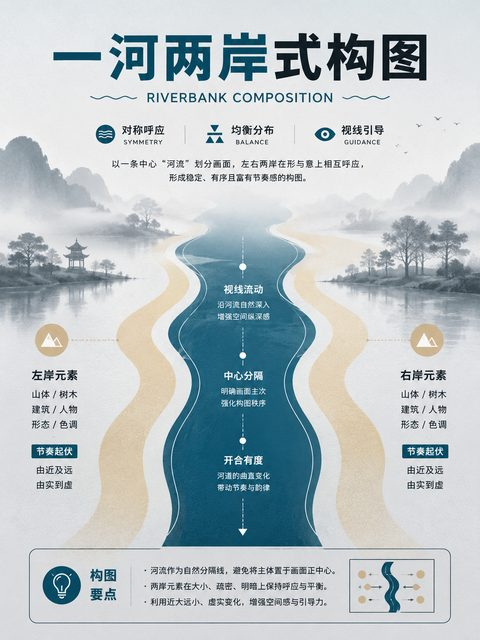</a> | <a href="../../v2/images/07-chinese-composition/323-边角式构图.png">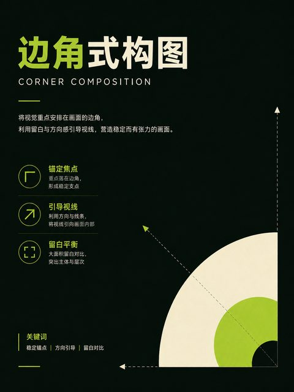</a> | <a href="../../v2/images/07-chinese-composition/324-截景式构图.png">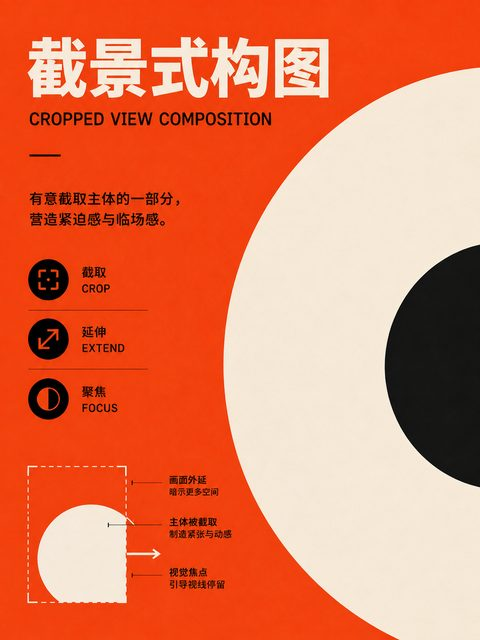</a> |
| :---: | :---: | :---: | :---: |
| **321** 全景式构图 | **322** 一河两岸式 | **323** 边角式构图 | **324** 截景式构图 |

| <a href="../../v2/images/07-chinese-composition/325-折枝式构图.png">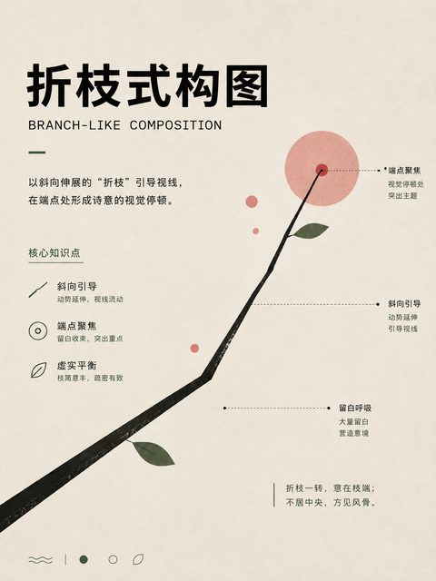</a> |  |  |  |
| :---: | :---: | :---: | :---: |
| **325** 折枝式构图 | &nbsp; | &nbsp; | &nbsp; |

## 留白、虚实与章法 · 9 种

计白当黑、疏密、主宾、开合、藏露与欹正。 `326–334`

| <a href="../../v2/images/07-chinese-composition/326-留白构图.png">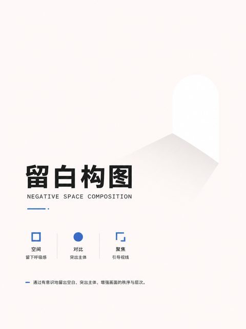</a> | <a href="../../v2/images/07-chinese-composition/327-计白当黑构图.png">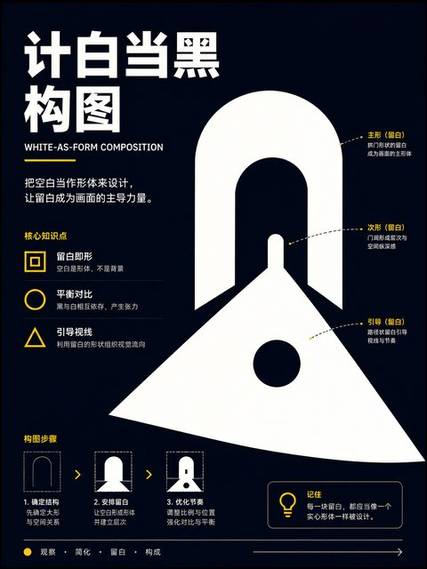</a> | <a href="../../v2/images/07-chinese-composition/328-虚实相生构图.png">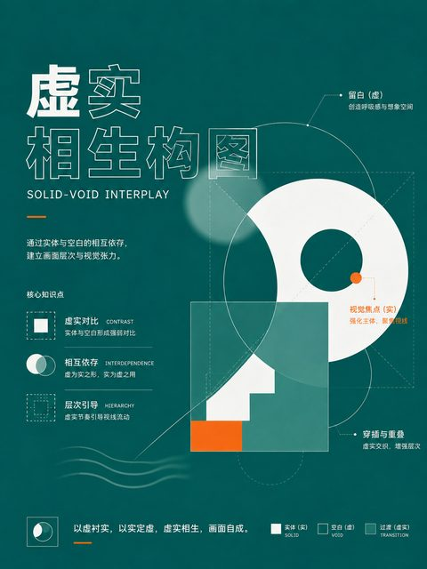</a> | <a href="../../v2/images/07-chinese-composition/329-疏密相间构图.png">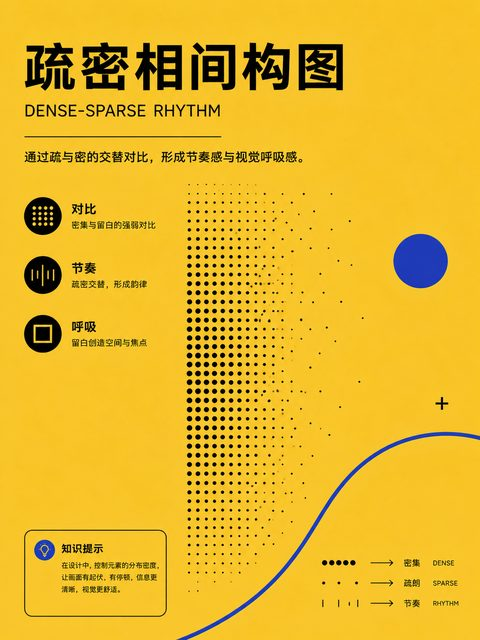</a> |
| :---: | :---: | :---: | :---: |
| **326** 留白构图 | **327** 计白当黑构图 | **328** 虚实相生构图 | **329** 疏密相间构图 |

| <a href="../../v2/images/07-chinese-composition/330-主宾关系构图.png">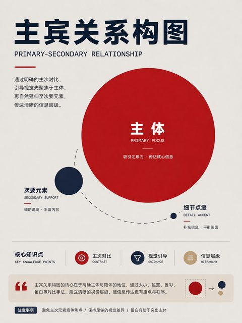</a> | <a href="../../v2/images/07-chinese-composition/331-开合构图.png">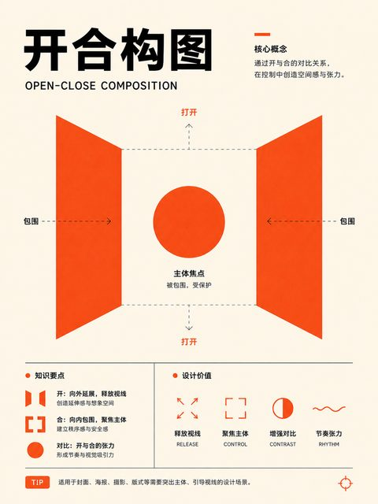</a> | <a href="../../v2/images/07-chinese-composition/332-起承转合构图.png">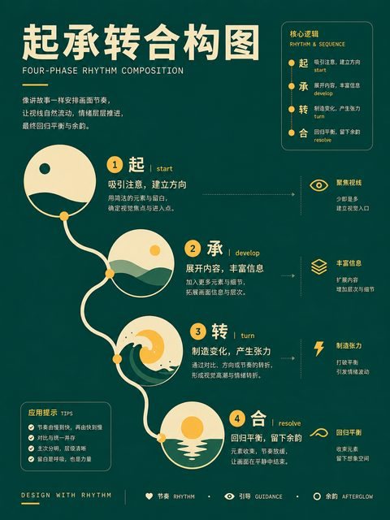</a> | <a href="../../v2/images/07-chinese-composition/333-藏露关系构图.png">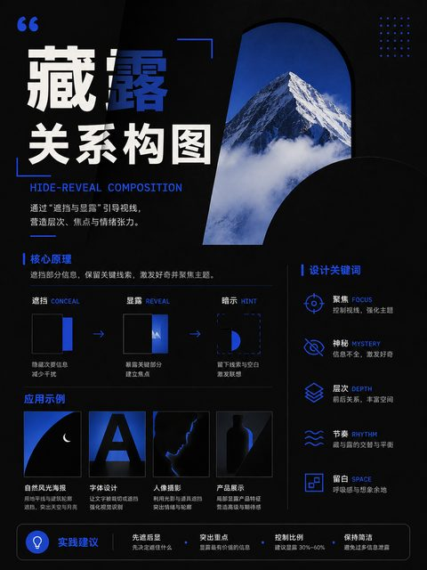</a> |
| :---: | :---: | :---: | :---: |
| **330** 主宾关系构图 | **331** 开合构图 | **332** 起承转合构图 | **333** 藏露关系构图 |

| <a href="../../v2/images/07-chinese-composition/334-欹正关系构图.png">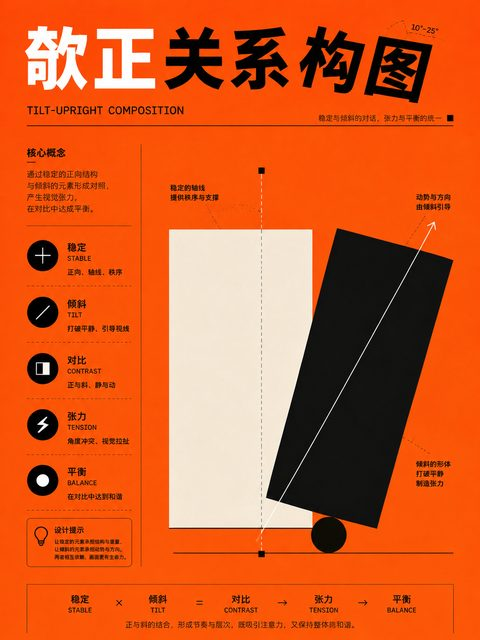</a> |  |  |  |
| :---: | :---: | :---: | :---: |
| **334** 欹正关系构图 | &nbsp; | &nbsp; | &nbsp; |
